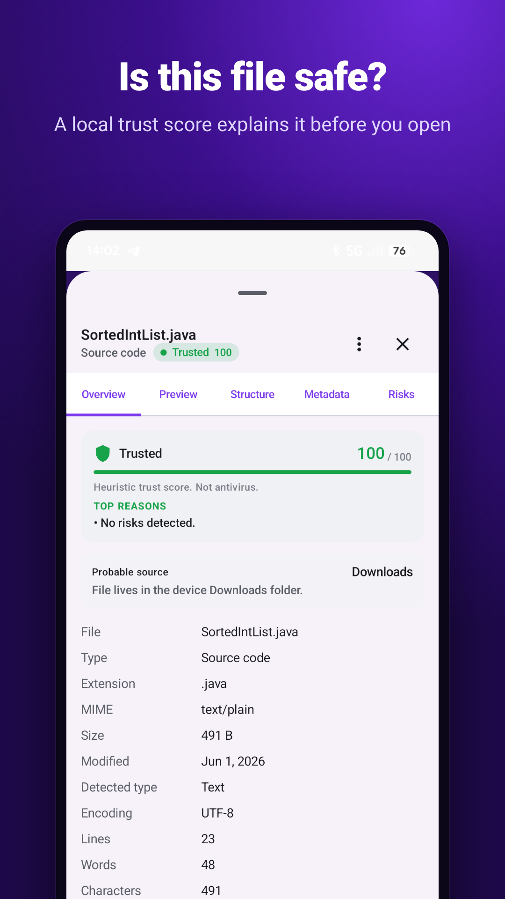
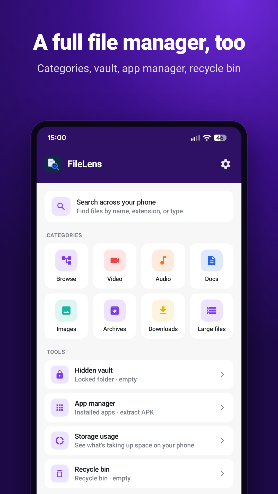
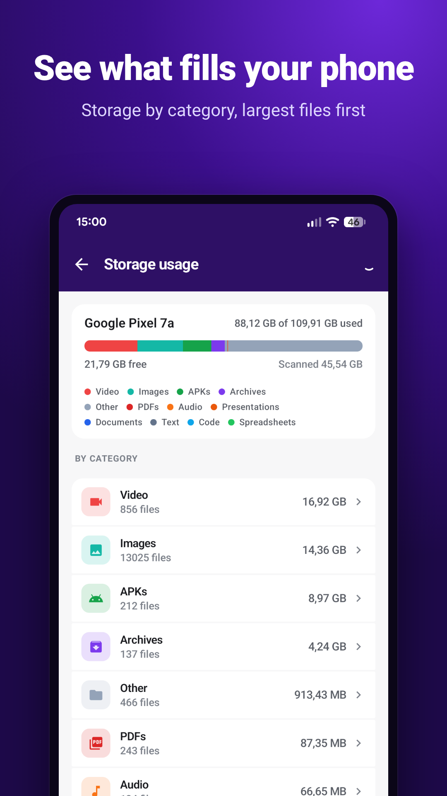
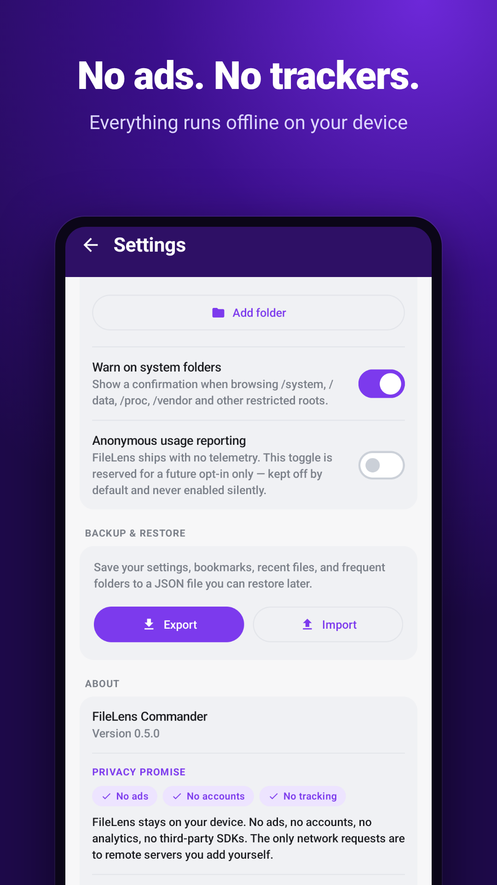
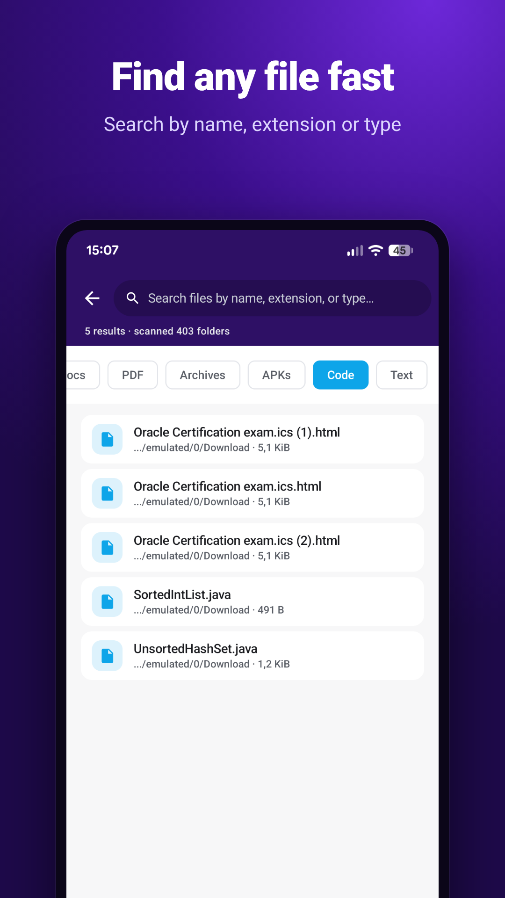

<div align="center">


# FileLens

**A file manager for Android that shows you what's inside a file before you open or share it.**

[](https://github.com/andybuki/filelens/actions/workflows/android-ci.yml)
[](LICENSE)
[](#build-from-source)

<a href="https://play.google.com/store/apps/details?id=app.com.filelens&referrer=utm_source%3Dgithub%26utm_medium%3Dreadme"></a>

No ads · No trackers · No account · Works offline

</div>

<p align="center">
  
  
  
  
  
</p>

## Why FileLens

Photos carry the exact GPS location where they were taken. Office files keep
author names, tracked changes and hidden sheets. A "wedding_invitation.jpg"
sent in a chat can be an Android app. FileLens shows this before you open or
share the file, and removes the hidden data in one tap. Everything happens on
your device.

## Features

**Inspector**
- Real file type from magic bytes, so a `.jpg` that is really an APK is flagged.
- Explainable risk cards (*what was found, why it matters, what to do*) and a local trust score. Heuristic, not an antivirus.
- Images: EXIF with GPS, camera, dates. Documents: DOCX/XLSX/PPTX revisions, hidden sheets, macros, external links. PDF: JavaScript, embedded files, encryption.
- APK: permissions, signatures, debug flags, trackers, native libraries.
- Archives (ZIP, RAR, 7z, TAR, JAR, APK, EPUB) browsed without extracting; SQLite, JSON, XML, YAML, `.env` with a secrets scan; hex viewer and entropy.

**Privacy**
- Safe Share: strips EXIF, OOXML and PDF metadata before sharing.
- "Share without location" and "Inspect with FileLens" entries in Android's share menu, usable without opening the file manager.
- Batch privacy audit of a folder, reports in Markdown or JSON.

**File manager**
- Dual-pane commander on tablets and Samsung DeX, keyboard and F-key shortcuts.
- Recycle bin with undo, hidden vault, batch rename with regex, duplicate finder (SHA-256), file and folder compare.
- FTP, SFTP and SMB; home-screen widget; Material You and a free dark theme.
- 15 languages.

## Privacy

FileLens has no servers, no analytics and no advertising SDKs. Files are read
and changed only on your device; network access is used only for remote
servers you add yourself. See the [privacy policy](PRIVACY_POLICY.md).

There is also a browser version of the photo and fake-file check:
[FileLens Check](https://andybuki.github.io/filelens-check/) ([source](https://github.com/andybuki/filelens-check)).

## Build from source

Requirements: JDK 17 and the Android SDK (API 36). Android Studio works out of the box.

```bash
git clone https://github.com/andybuki/filelens.git
cd filelens
./gradlew assembleDebug          # app/build/outputs/apk/debug/app-debug.apk
./gradlew testDebugUnitTest      # unit tests
./gradlew lintDebug              # Android lint
```

## Project structure

```
app/src/main/java/com/filelens/commander/
├── ui/          Jetpack Compose screens, components, theme (phone + tablet layouts)
├── viewmodel/   Screen state
├── domain/      Models and use cases (trust score, secret scanner, ...)
├── inspector/   One inspector per format (image, PDF, Office, APK, ZIP, SQLite, ...)
├── detector/    Magic-bytes file type detection
├── vfs/         Virtual file system: local files, archive entries, remote servers
├── data/        Settings, bookmarks, encrypted credentials
├── di/          Hilt modules
└── widget/      Home-screen widget
app/src/main/play/   Play Store listing in 15 languages (published by CI)
design/              Design system: tokens, brand assets, UI kit prototypes
store/               Screenshot generator and store assets
```

Kotlin, Jetpack Compose, Material 3, Hilt, Coroutines/Flow, Coil. Min SDK 26, target SDK 36.
See [ROADMAP.md](ROADMAP.md) for what is done and what is next.

## Contributing

Bug reports, translations and pull requests are welcome. Please read
[CONTRIBUTING.md](CONTRIBUTING.md) first. Report security problems privately,
as described in [SECURITY.md](SECURITY.md).

## License

FileLens is free software under the [GNU General Public License v3.0](LICENSE).
You may use, study, share and modify it; distributed copies and derivatives
must stay under the same license with their source code available.

Roboto fonts in `design/fonts` are under their own licenses (Apache 2.0 / SIL OFL).
Google Play and the Google Play logo are trademarks of Google LLC.
